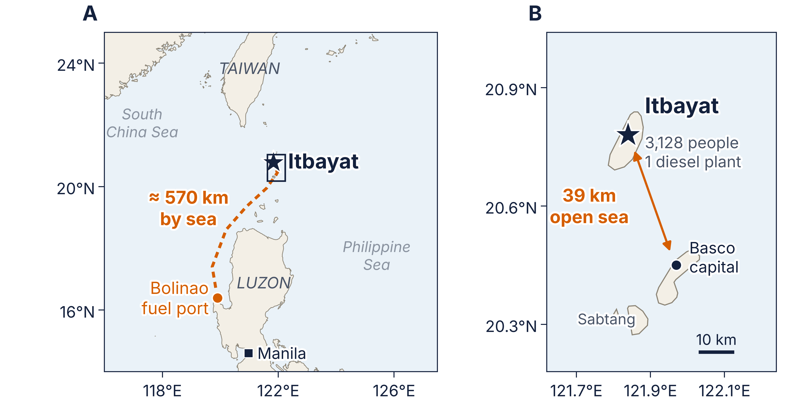
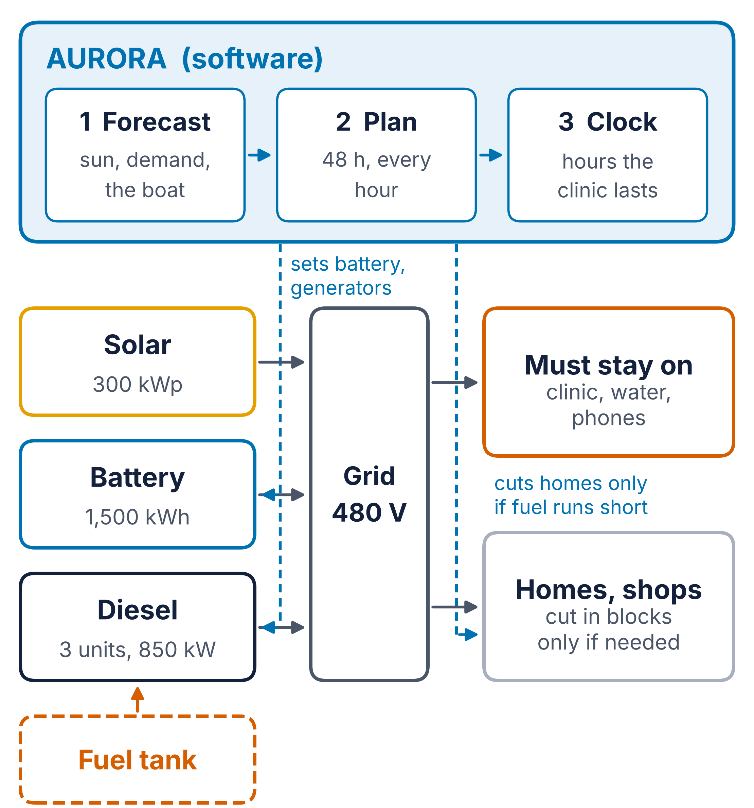
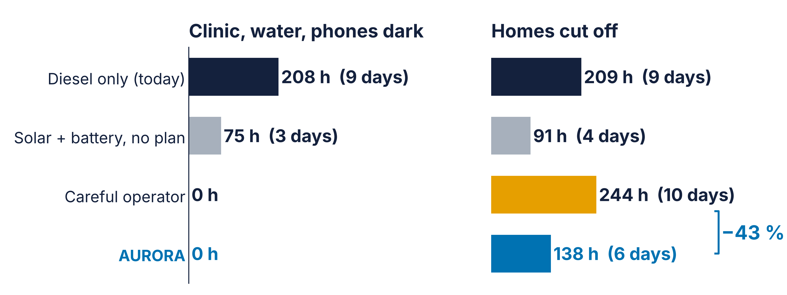

<div align="center">

# AURORA

**Clean-energy software for diesel islands**

Burn less fuel every day. Keep the clinic, water and phones on when storms stop the fuel boat.


-14213D)


Global Sustainability Challenge 2026–27 · Theme: Sustainable Energy · Case study: Itbayat, Philippines

</div>

---

## Contents

1. [The problem](#the-problem)
2. [What AURORA does](#what-aurora-does)
3. [Results](#results)
4. [Quick start](#quick-start)
5. [Repository structure](#repository-structure)
6. [Reproduce the full study](#reproduce-the-full-study)
7. [Method](#method)
8. [Data, sources and limits](#data-sources-and-limits)

---

## The problem

Itbayat (3,128 people) gets all its power from one diesel plant, and every litre of fuel arrives by boat from about 570 km away. Storms close that route several times a year: in past fuel crises the island had **6 hours of power a day**. Hundreds of Philippine islands share the same set-up, and the national plan adds solar and batteries to 147 of these plants by 2030. That hardware is sized to save fuel, not to ride out a two-week gap.

<p align="center"></p>

## What AURORA does

AURORA is the software layer above an island's solar, battery and diesel plant. Every hour it:

1. **Forecasts** sun and demand 48 h ahead, with a bad, typical and good case.
2. **Plans** generators, battery and, only if fuel will run short, which blocks of homes to cut. The clinic, water and phones are never cut.
3. **Shows one number**, the **Survival Clock**: how many hours the critical services would last if diesel stopped now.

<p align="center"></p>

It starts as advice to the plant operator (screen or text message) and can later send set points to the plant's own controller, which keeps its safety limits.

## Results

Digital twin of Itbayat, chosen system **300 kWp solar + 1,500 kWh battery**. Three real typhoons (Mawar 2023, Ragasa 2025, Mekkhala 2026) replayed with the fuel boat 14 days late, plus two full normal years.

| | Diesel only (today) | Solar + battery, no plan | Careful operator ¹ | **AURORA** |
|---|---:|---:|---:|---:|
| Clinic, water, phones dark (h) | 208 | 75 | 0 | **0** |
| Homes cut off (h) | 209 | 91 | 244 | **138** |
| Diesel in a normal year (L) | 341,900 | 232,800 | 232,800 | **215,700** |

¹ Rations fuel by hand from day one and is told exactly when the boat arrives.

<p align="center"></p>

**In numbers**

- **−37 % diesel** a year: 126,000 L, **338 t CO₂** and 10 to 14 M PHP of fuel. About 420 MWh of solar used, 35 % of demand.
- **−43 % hours of home cuts** against the careful operator (−19 % in energy).
- **Clinic stays on** with one generator lost, half the solar gone, or no internet.
- **Forecast** error 11 % below the best raw global model (ECMWF) the next day, 6 % below a bias-corrected model average; its 80 % range holds 82 % of hours.

Every number on the competition slides is recomputed from the stored results by one script and listed with its source in **[docs/headline_numbers.md](docs/headline_numbers.md)**.

**What does not work yet:** if the clinic shares a feeder with homes, AURORA's cuts reach it (72 h dark). A dedicated clinic feeder comes first. Two days ahead and near a typhoon, the forecast is not yet better than a plain model average.

## Quick start

Needs Python 3.10 or newer. No internet or paid software: all inputs and results are in the repository.

```bash
git clone https://github.com/Malmand/Aurora.git
cd Aurora
pip install -e ".[dev]"

make test       # 64 automatic checks
make figures    # every deck number and figure, from stored results (under a minute)
make check      # fails if any deck number no longer follows from the results
```

Outputs: `results/headline.json`, `docs/headline_numbers.md` and `figures/slides/` (PDF + 300 dpi PNG).

## Repository structure

```
aurora/
├── data/          site values, weather and typhoon inputs, NPC-matched demand, PV model
├── forecast/      sun and demand forecast (quantile ML + conformal), backtest, bias-corrected check
├── twin/          digital twin: plant, fuel tank, four controllers, AURORA optimiser, Survival Clock
├── experiments/   typhoon replays, normal years, sizing sweep, stress tests (phase4b.py)
│                  headline.py: every deck number from the results
├── plotting/      slides.py: every deck figure; style.py; calibration.py
└── run_all.py     rebuild numbers and figures in one command
data/itbayat/      site.yaml + SOURCES.md (every input with its source), raw_small/ (all external inputs)
results/           phase4b/ (current results, hour by hour), headline.json
figures/slides/    deck figures
docs/              method and validation notes (see below)
tests/             pytest suite
```

| Document | What it covers |
|---|---|
| [docs/headline_numbers.md](docs/headline_numbers.md) | every deck number, its value and source file |
| [docs/model_v2.md](docs/model_v2.md) | the five changes that made the model less kind to AURORA |
| [docs/twin.md](docs/twin.md) | plant, fuel tank, optimiser, Survival Clock, assumptions |
| [docs/validation_forecast.md](docs/validation_forecast.md) | 24-month forecast backtest, typhoon hours, bias-corrected baseline |
| [docs/validation_site.md](docs/validation_site.md) | weather data checked against PAGASA and published studies |
| [data/itbayat/SOURCES.md](data/itbayat/SOURCES.md) | every site number with source, status and sensitivity range |

## Reproduce the full study

The simulations behind `results/` take hours of CPU and resume where they stop.

```bash
python scripts/download_itbayat.py                               # external inputs -> data/itbayat/raw_small/
python -m aurora.data.build_itbayat                              # site data (add --load plant_log.csv for real logs)
python -m aurora.forecast.build                                  # forecast backtest (~15 min)
python -m aurora.forecast.mos_check                              # forecast vs bias-corrected weather models
python -m aurora.twin.run --demo                                 # twin demo on typhoon Mawar 2023
python -m aurora.experiments.phase4b run --stage A --workers 8   # sizing sweep, NPC and INL sizes
python -m aurora.experiments.phase4b run --stage B --workers 8   # chosen size: storms, years, stress tests
python -m aurora.experiments.phase4b tables
make figures
```

## Method

- **Forecast** (`aurora/forecast/`): predicts the clear-sky index from archived ECMWF, GFS, ICON and JMA runs that existed at issue time. LightGBM quantile regression (19 levels), monthly refit, split-conformal calibration. Falls back to persistence and climatology with wider bands when the internet is down.
- **Digital twin** (`aurora/twin/`): hourly plant with three diesel units and a fuel curve, battery limits, fuel tank with a 250 L reserve, and homes cut in whole feeder blocks as line crews do.
- **AURORA controller**: a mixed-integer optimiser (PuLP + HiGHS, under a second per hour) over the forecast horizon, with three boat-delay scenarios and the forecast range. It applies the first hour, then re-plans.
- **Survival Clock (CEST)**: hours the critical load runs on battery and pessimistic sun with diesel off, capped at 72 h.
- **Sizing rule**: the cheapest size where the clinic never goes dark and the Survival Clock keeps at least 24 h in the worst storm.

## Data, sources and limits

Inputs come from official reports and datasets: NPC Missionary Electrification Plan 2025–2029, the INL study of Itbayat ([doi:10.2172/3014068](https://doi.org/10.2172/3014068)), ERC Order 2025-060 RC, ERA5 ([Hersbach et al. 2020](https://doi.org/10.1002/qj.3803)), IBTrACS ([Knapp et al. 2010](https://doi.org/10.1175/2009BAMS2755.1)), [Castro et al. 2022](https://doi.org/10.1016/j.energy.2022.124599) and [Ocon and Bertheau 2019](https://doi.org/10.13044/j.sdewes.d6.0230). News reports are used only as evidence that fuel crises happened.

**Limits, stated plainly**

- No hourly plant data is public, so demand is **synthetic**: its shape is modelled and its yearly peak and energy match NPC's records within 2 %.
- The fuel tank size (52,000 L) and storm-start level (6,000 L) are assumptions.
- Weather "truth" is satellite and reanalysis data, not a sensor on the island.
- The careful operator is told the boat's delay in advance, which favours him.

Every assumption has a sensitivity range in [data/itbayat/SOURCES.md](data/itbayat/SOURCES.md). Plant logs, fuel records and a feeder map from NPC-SPUG and BATANELCO would replace the main ones.

---

<sub>Team repository: [aurora-gsc/aurora-digital-twin](https://github.com/aurora-gsc/aurora-digital-twin).</sub>
