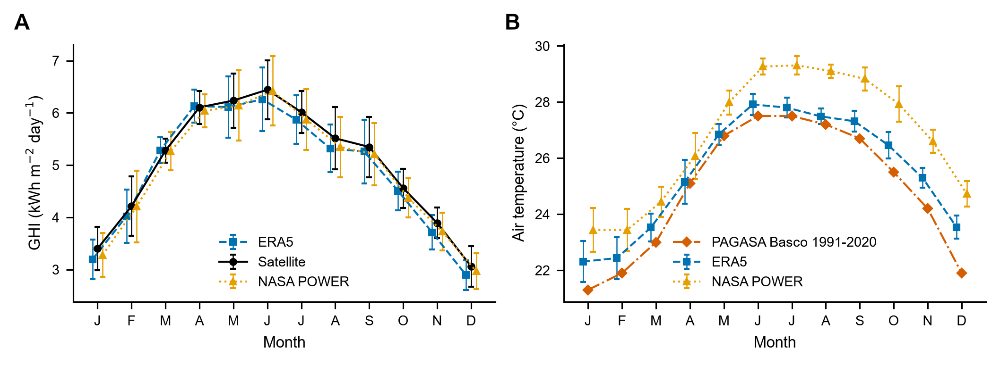

# Site validation: Itbayat weather data

Generated by `python -m aurora.data.build_itbayat` on 2026-11-02. Every product here is a reanalysis or a satellite retrieval. None is a ground measurement. Statistics use full calendar years only (at least 99 % of hours present).

## Data availability

| Product | Status | Full years | Grid point |
|---|---|---|---|
| ERA5 | ERA5 reanalysis (Hersbach et al. 2020) via Open-Meteo historical API, models=era5 | 2015-2025 (11) | 20.75, 121.75 |
| Satellite | Open-Meteo satellite radiation API | 2015-2025 (11) | 20.773285, 121.85036 |
| NASA POWER | NASA POWER hourly v2 (CERES SYN1deg radiation, MERRA-2 meteorology) | 2015-2025 (11) | 20.78, 121.84 |

## 1. Monthly GHI across products

Monthly mean of daily GHI in kWh/m²/day (mean ± SD across years). The satellite product is the reference, because it observes the clouds; ERA5 and NASA POWER model or derive them.

| Month | ERA5 | Satellite | NASA POWER | ERA5 vs Sat (%) | NASA POWER vs Sat (%) |
|---|---|---|---|---|---|
| Jan | 3.19 ± 0.38 | 3.40 ± 0.42 | 3.28 ± 0.42 | -6.1 | -3.6 |
| Feb | 4.02 ± 0.51 | 4.21 ± 0.57 | 4.21 ± 0.69 | -4.6 | -0.1 |
| Mar | 5.28 ± 0.25 | 5.28 ± 0.23 | 5.26 ± 0.37 | +0.1 | -0.3 |
| Apr | 6.13 ± 0.32 | 6.11 ± 0.32 | 6.04 ± 0.32 | +0.4 | -1.1 |
| May | 6.11 ± 0.59 | 6.24 ± 0.52 | 6.14 ± 0.67 | -2.0 | -1.6 |
| Jun | 6.26 ± 0.61 | 6.44 ± 0.56 | 6.42 ± 0.67 | -2.8 | -0.3 |
| Jul | 5.87 ± 0.47 | 6.01 ± 0.40 | 5.87 ± 0.58 | -2.4 | -2.4 |
| Aug | 5.32 ± 0.46 | 5.51 ± 0.60 | 5.35 ± 0.58 | -3.5 | -3.0 |
| Sep | 5.26 ± 0.61 | 5.35 ± 0.58 | 5.21 ± 0.59 | -1.6 | -2.6 |
| Oct | 4.50 ± 0.37 | 4.56 ± 0.37 | 4.37 ± 0.37 | -1.2 | -4.1 |
| Nov | 3.71 ± 0.33 | 3.89 ± 0.29 | 3.73 ± 0.36 | -4.7 | -4.3 |
| Dec | 2.89 ± 0.28 | 3.06 ± 0.39 | 2.97 ± 0.34 | -5.4 | -3.1 |
| **Year** | **4.88** | **5.01** | **4.90** | **-2.5** | **-2.0** |

- **ERA5 vs satellite, annual GHI: -2.5 %, agrees.**
- **NASA POWER vs satellite, annual GHI: -2.0 %, agrees.**

Hourly comparison, hours with satellite GHI > 20 W/m²:

| Product | n hours | MBE (W/m²) | MAE (W/m²) | RMSE (W/m²) | rMBE (%) | rRMSE (%) | r | best lag (h) |
|---|---|---|---|---|---|---|---|---|
| ERA5 | 46098 | -11.0 | 47.4 | 83.4 | -2.5 | 19.1 | 0.953 | +0 |
| NASA POWER | 46097 | -8.9 | 61.0 | 92.5 | -2.0 | 21.2 | 0.943 | +0 |

A best lag of 0 h confirms that both series use the same hour-ending time label. NASA POWER is re-labelled from hour-start to hour-ending at download.

## 2. Temperature vs PAGASA Basco normals (2001-2020)

| Month | ERA5 (°C) | NASA POWER (°C) | PAGASA Basco (°C) | ERA5 − PAGASA (°C) | NASA POWER − PAGASA (°C) |
|---|---|---|---|---|---|
| Jan | 22.3 | 23.4 | 21.3 | +1.0 | +2.1 |
| Feb | 22.4 | 23.4 | 21.9 | +0.5 | +1.5 |
| Mar | 23.5 | 24.4 | 23.0 | +0.5 | +1.4 |
| Apr | 25.2 | 26.1 | 25.1 | +0.1 | +1.0 |
| May | 26.8 | 28.0 | 26.8 | +0.0 | +1.2 |
| Jun | 27.9 | 29.3 | 27.5 | +0.4 | +1.8 |
| Jul | 27.8 | 29.3 | 27.5 | +0.3 | +1.8 |
| Aug | 27.5 | 29.1 | 27.2 | +0.3 | +1.9 |
| Sep | 27.3 | 28.8 | 26.7 | +0.6 | +2.1 |
| Oct | 26.5 | 27.9 | 25.5 | +1.0 | +2.4 |
| Nov | 25.3 | 26.6 | 24.2 | +1.1 | +2.4 |
| Dec | 23.5 | 24.7 | 21.9 | +1.6 | +2.8 |

- **ERA5 vs PAGASA, annual mean temperature: +0.6 °C, agrees** (tolerance ±1 °C).
- **NASA POWER vs PAGASA, annual mean temperature: +1.9 °C, investigate** (tolerance ±1 °C).
- Part of any warm bias is expected: the Basco station sits at 167 m (about 1 °C cooler than sea level at a standard lapse rate), the gridded products are ocean-dominated, and they cover 2015 onwards while the normals cover 2001-2020. The PDF is headed 2001-2020 although its URL says 1991-2020.

## 3. Solar resource vs Tsai et al. (2020)

- Tsai et al. (2020) give monthly GHI only as a chart, so only the annual value is compared. Their site is Batan Island (Basco), about 45 km from Itbayat.

- **ERA5 annual mean 4.88 kWh/m²/day vs Tsai et al. 5.14 kWh/m²/day (1,876 kWh/m²/yr): -5.1 %, acceptable.**
- **Satellite annual mean 5.01 kWh/m²/day vs Tsai et al. 5.14 kWh/m²/day (1,876 kWh/m²/yr): -2.6 %, agrees.**
- **NASA POWER annual mean 4.90 kWh/m²/day vs Tsai et al. 5.14 kWh/m²/day (1,876 kWh/m²/yr): -4.6 %, agrees.**

## 4. Annual PV specific yield

Fixed array, tilt 20°, facing south, PVWatts DC (γ = -0.0037 /°C), SAPM open-rack cell temperature, 14 % DC losses, inverter efficiency 0.96, Hay-Davies transposition (pvlib). These are ASSUMPTIONs for a check, not the design array.

| Product | Mean (kWh/kWp/yr) | Min | Max | Years |
|---|---|---|---|---|
| ERA5 | 1443 | 1364 | 1509 | 11 |
| Satellite | 1481 | 1400 | 1548 | 11 |
| NASA POWER | 1466 | 1361 | 1584 | 11 |

Air temperature from ERA5; wind from ERA5.

- **Pending vs Castro et al. (2022).** `data/itbayat/reference/castro2022_itbayat.csv` is not yet transcribed (Mendeley Data host blocked from the cloud session).

## Figure

**Figure.** (A) Monthly mean daily GHI by product, mean ± 1 SD across full years. (B) Monthly mean air temperature by product with PAGASA Basco normals.

